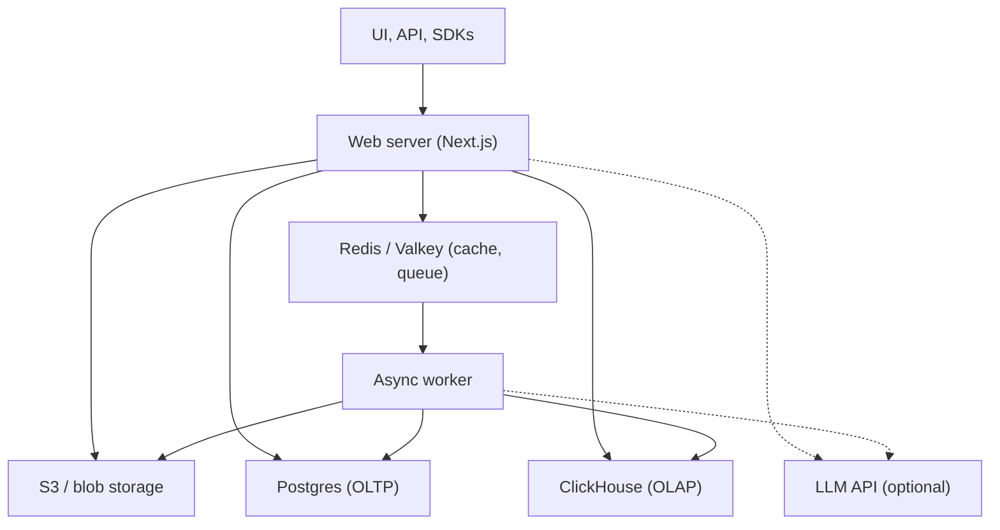

# Langfuse architecture notes

Source: the main repo's CONTRIBUTING.md (read 2026-10-15). To be extended as I read the code.

## Components

## Ideas worth understanding

| Idea | Where it shows | Why it matters |
|---|---|---|
| OLTP / OLAP split | Postgres for users, projects, prompts; ClickHouse for traces and observations | Transactional data and huge analytical volumes need different engines |
| Queue-backed writes | Web stores the raw event in S3, enqueues a job in Redis; the worker writes to ClickHouse | Absorbs traffic spikes; ingestion stays fast |
| Unordered ingestion | `observation.trace_id` is deliberately **not** a DB foreign key | An observation can arrive before its trace; integrity moves into application code |
| Partial success | Ingestion API returns `207` with per-event errors | One bad event doesn't fail a whole batch |
| Native hot path | Worker loads a Rust addon (napi-rs); the AI gateway is Rust | Performance where it counts, TypeScript elsewhere |
| Agent-ready repo | `.agents/AGENTS.md`, shared skills, an MCP catalog that generates per-tool config | A reference design for running many coding agents on one codebase |
| Release flow | `main` -> staging + per-PR previews; promote `main` to `production` for Cloud; separate OSS Docker release | Continuous cloud deploys alongside slower self-hosted releases |

## Ingestion path (to trace end to end)

`/public/api/ingestion`: validate each event, store raw, count tokens for generations,
match the model to the `models` table for cost, upsert into traces/observations.

- [ ] Follow one real trace from my LinkedIn pipeline through web -> S3 -> Redis -> worker -> ClickHouse
- [ ] Read the Python SDK's OTel exporter and batching (`langfuse/_client/`)
